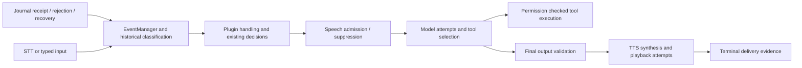

# TARS Black Box V1

Black Box records observable software evidence during a backend session. It does
not capture a model's hidden reasoning, measure whether you heard audio, or decide
when TARS should speak. It extends the existing SpeechTrace hooks and uses the
same speech/event/model/TTS identifiers.

## Using it

Open **Settings → Diagnostics → Black Box** in the local desktop application.
Standard recording starts automatically before configuration and plugin loading.
The panel shows recording state, the current session ID, written/dropped/queued
counts, recent activity, and earlier retained sessions. Refresh happens every five
seconds while the panel is mounted. Component, severity and decision-reason filters
apply to the recent retained window, up to 200 rows. Export to inspect the complete
retained window of an older or longer session.

Use **Export sanitized JSONL** for Codex analysis, or **Export readable TXT** for
human review. Review an export before sharing it. The ordinary **Export diagnostics**
support bundle is unchanged and does not include Black Box files.

The recorder normally writes to:

```text
%APPDATA%\TARS\logs\blackbox\
```

**Open Black Box folder** opens that fixed location; the renderer cannot supply an
arbitrary path. Source development without APPDATA uses
`~/.local/share/TARS/logs/blackbox`. This does not move the existing configuration,
providers, database or user assets. One backend process is one Black Box session;
a backend restart creates a new session and records the prior session ID when
available. A game encounter and a backend session are different things.

Black Box controls and export responses are local-desktop only. They are excluded
from Electron's ordinary transport logs, remote-interface broadcasts and recent-
message replay cache, including base64 export chunks. Remote chat and other existing
runtime controls are unaffected.

## Recording modes and privacy

**Standard** is automatic and records only allowlisted diagnostic metadata:
event types, time/order, opaque salted event/journal/model/tool identities,
source/component labels, historical flags, selected safe measurements and counts,
decision codes, durations, token usage when reported, and delivery evidence.
For example a Water World scan can retain its class and terraformability flag,
without the raw body/system name or journal document. Unknown/custom string labels
are reported as `not_reported`; custom model/provider/tool identifiers also receive
opaque session-local fingerprints. Hashes are not reversible lookup tables and are
not stable across backend sessions.

Standard does **not** store raw conversations, complete prompts, model response
text, screenshots, API keys, headers, personal file paths, raw journal documents,
or hidden reasoning. No audio recording or image file is created by Black Box.

**Verbose Debug** requires an explicit confirmation in Diagnostics. It may retain
bounded, redacted commander input, selected final model output, selected event/status
evidence and tool argument/result text in separate `*.private.jsonl` files. It does
not capture the system/personality prompt or model reasoning fields. Input evidence
is selected context, not an assertion that the entire model context is retained.
Context is capped at 4,096 characters per allowed field and 8 KiB per record; `context_truncated` reports
truncation. Ordinary support bundles never include this stream.

Verbose context is private even after redaction. It can contain personal conversation,
named places and other sensitive information that pattern matching cannot recognize.
Credential-bearing or explicit internal prompt/reasoning context is withheld;
recognized secret tokens, URLs, email addresses and personal paths are redacted.
Do not enter secrets in conversation. Local files are not encrypted; protect the
Windows account/profile. Files use user-only POSIX permissions where applicable;
Windows files inherit profile ACLs. Physical installation/ACL acceptance is still
required. No diagnostics are uploaded automatically.

**Export PRIVATE context** requires a separate confirmation and produces a clearly
labelled `PRIVATE` filename. It combines private supplements with the standard
records by sequence, so they are not counted as extra model calls. Standard is
restored on every backend restart. Only storage limits persist in `limits.json`;
no recording-mode preference, user prompt or personality setting is changed.

## What is recorded



- Journal parsing failures/recovery and dispatched IDs link to EventManager receipt
  through `journal_id`. `event_id` joins receipt, processing, eligibility and reply
  events. Child plugin/projected events can carry `parent_event_id`.
- Plugin callbacks are observed, not rerun for diagnostics. The host translates
  Explorer's existing recorded outcomes: history reconstruction, disabled automatic
  callouts, already announced, same-body cooldown, repeated idea, no noteworthy
  criteria, dispatched or dispatch failed. `expected_callout` is separate from
  `accepted`: expected scientific value is not a promise of speech delivery.
- Navigator/Explorer direct-priority messages and known Chatter silence/retry
  messages become fixed codes through the existing SpeechTrace message observer.
  Chatter's own opportunity diagnostics continue to report cooldown, user/assistant
  activity, missing/used context, intentional silence, quality rejection and admission.
- Observatory's exposed relay/historical/non-notification/malformed counters are
  sampled on the recorder worker about every ten seconds. They are cumulative
  observed counts, not reconstructed individual facts. No raw feed path or free-text
  error is captured. Counter samples need not have a reply trace.
- Combat focus changes, ordinary speech suppression, alert dispatch/host selection,
  selected ship/fighter flags and damage evidence, and configured alert/focus/control
  booleans are observable. Black Box does not add or modify Combat decisions. The
  tracker does not expose every rejected critical-alert condition, so an absent
  alert cannot always be assigned a precise causal reason from Standard alone.
- The real prompt assembler reports character counts and its freshness label.
  Optional verbose status/event context helps inspect what was supplied; no extra
  tool, memory query or model call is made for diagnostics.
- Concrete model calls retain attempt IDs, model/provider identity or fingerprints,
  elapsed duration, visible output length, and selected tool names. Token counts are
  included when nonzero usage is available; unreported usage is not invented as zero.
  Provider rejection categories and SDK-reported retry counts remain observations.
- Tool requests, existing permission refusals, malformed arguments, returned results
  and caught execution failures are recorded. A method returning is not proof the
  game action succeeded. Reported tool result flags remain explicitly reported facts.
- STT capture/transcription stages, failures/discards, device fallback and worker
  recovery link accepted voice input to its conversation event. TTS records queueing,
  synthesis/device state, playback attempts, interrupts/failures and terminal outcome.
- Application/plugin startup, failed initialization, cleanup failures, unhandled
  worker exceptions, normal shutdown and prior unclean sessions are observed. A
  startup bundle metadata record contains the reported canonical plugin revision;
  it is not a substitute for source-byte verification.

## Reading the timeline

Each JSONL record has a schema version, UTC timestamp, monotonic milliseconds,
session ID and increasing sequence number, plus relevant correlation fields.
Monotonic time is meaningful within a process. UTC time permits approximate
comparison with Elite journals; it is not proof of synchronized clocks.

`trace_id` groups a particular runtime operation. One commander interaction can
cross multiple threads and traces; join it by `event_id`, `parent_event_id`,
`journal_id` and Chatter `reservation_id`. `generation_id` groups a logical reply;
model `attempt_id` distinguishes concrete calls/retries. `delivery_id`/`line_id`
identify the queued line; TTS attempt IDs distinguish retry playback of that same
line. Repeated playback and repeated model calls can therefore be separated.

`historic: false` means the event is not marked historical, not proof that every
fact is fresh. The prompt's `LIVE`, `CURRENT SNAPSHOT` and `LAST KNOWN` freshness
labels describe the existing assembler's assessment, not new Black Box validation.
Source uncertainty must not be promoted to live truth by an analyst.

A speech admission proposal in **observe** mode is not an enforced suppression.
Read `enforced`, `proposed`, `selected` and the later output/delivery records together.
A plugin dispatch, model completion or UI text is not evidence of completed audio.
`written_bytes`, `output_drained` and terminal outcomes describe available software
output evidence. `playback_success: unknown` stays unknown: returned PCM writes do
not prove speaker audibility or the commander's attention.

Silence can mean reaction disabled, historical input, semantic coverage, freshness,
busy/deferred work, Combat Focus, deliberate Chatter silence, unavailable context,
quality rejection, model abstention, cancellation or output failure. Where software
reports no reason, the record says `not_reported`. Absence of a record is never
proof of an intentional decision to remain silent. Black Box cannot explain why a
model internally preferred a tool; it can show the observed selection and optional
input/output context.

## Bounds, backpressure and crashes

The producer uses a bounded 2,048-entry queue and a nonblocking admission lock. A
single writer serializes UTF-8 JSONL. Producers never perform disk writes or wait
for export, and logging exceptions do not escape into speech/actions. Contention,
queue overload and oversized records can lose evidence. Dropped counts, rate-limited
loss records and sequence gaps make that limitation visible. Do not treat the
recorder as a lossless flight-data appliance.

Defaults are 8 MiB per segment, 16 segments per session, eight sessions, and a
256 MiB total JSONL budget. Segment size can be set to 1–16 MiB and session retention
to 1–20 in Diagnostics. The absolute record limit is 16 KiB. Private segments count
against the same recording budget. Active segments may temporarily exceed the
total budget by one bounded record. If Windows locks prevent part retention, new
parts are dropped instead of allowing unbounded growth. Older segments or sessions
are removed; a three-hour session is not guaranteed to fit. Watch counters, increase
limits if appropriate, and export before important evidence rotates out.

There is no second permanent TXT log. JSONL or TXT exports are prepared on a bounded
single command worker, read as 128 KiB chunks, and limited to 512 MiB per artifact.
At most two temporary export artifacts are retained, expiring after about fifteen
minutes; they can temporarily occupy up to 1 GiB in addition to the recording budget.
They are deleted after normal download. A concurrent export can expire an older
artifact. Export preparation/chunking does not block the gameplay loop. The UI
holds only a bounded recent window until the user explicitly downloads an export.

Each session has an atomic metadata checkpoint. An abrupt exit may leave an
incomplete final line or an unclean session. Export ignores incomplete/invalid rows,
reports read statistics, and marks completion. A new process starts a new session
rather than appending to a torn file. Files are not fsynced per event; a power loss
can lose recent OS-buffered writes. The checkpoint can lag by about ten seconds.
Export snapshots bound the read position so a continuously appending session does
not make the export infinite. Rotated/unavailable segments are reported as gaps.

A storage failure stops the recorder and is shown as unavailable in Diagnostics;
gameplay continues. Restart the backend after correcting disk permissions/space.
Shutdown waits at most two seconds for the writer; a permanently blocked filesystem
can outlive that wait. No native thread is forcibly killed.

## Practical debugging workflow

1. Use Standard for ordinary sessions. Note the UTC time of an unexpected event.
2. Open Diagnostics, verify recording and inspect dropped/queued counts.
3. Export the selected session as sanitized JSONL before it rotates out. Include the
   tested host build and what you expected TARS to do.
4. Follow journal/event IDs into plugin decisions, admission, model/tool attempts,
   output screening and delivery. Check whether metadata is live or historical.
5. If Standard does not contain sufficient context, reproduce with Verbose Debug
   explicitly enabled. Export PRIVATE context separately, inspect/redact it locally,
   and share it only deliberately. A missing software reason remains unresolved.

Examples: a Water World may have `expected_callout: true` followed by
`same_body_cooldown`, `automatic_callouts_disabled`, a dispatch followed by a speech
admission refusal, or successful generation followed by failed audio. These are
different failure boundaries. Long Chatter silence may correlate with actual
opportunity counters, not simply a quiet Elite journal. Old data can be followed
through historical flags and prompt freshness. A Combat alert not created by the
tracker has no invented rejection explanation.

## Verification and remaining acceptance

Deterministic tests use temporary logs, synthetic/sanitized journal fixtures, fake
models/audio and existing real host/plugin seams. They cover correlation,
permissions without controls, silence/retries, existing Explorer outcomes, Combat
restraint, concurrent producers, backpressure, rotation/retention, restart/torn tails,
Unicode/paths, sanitized/private exports, support exclusion and disk failures.
Frontend tests cover bounded filtering/export labels; Electron tests cover the
fixed folder and log/remote/cache privacy guards. Angular compilation checks the
actual Diagnostics templates. The inherited full host and canonical suites remain
required. `tools/benchmark_blackbox.py` measures a synthetic local burst only;
accepted and dropped observations are reported, never a live performance promise.

Run `python tools/update_blackbox_codes.py` after reviewing new instrumentation
labels; the fixed public catalogue prevents arbitrary producer strings entering
Standard metadata. Unknown labels intentionally fail closed to `not_reported`.

The branch is based on host #27 `98499ec4ab9ad59d42f05c47e586ac0a507bb884`, includes
Combat/corrective/reliability work, and excludes prompt experiment #28. Canonical
plugins remain pinned at `83caceaca39712d1c84e4337a09b020b087125ae`; all 32 payload
files must verify against exact source objects. No factory prompt, personality,
No reaction setting, action permission or Combat policy is changed.

Physical Windows 11 remains necessary for installed profile ACLs/folder opening,
real microphone/speaker hotplug, audible interruption, provider outages, suspend/
resume, overlay/game focus and several-hour Elite sessions. Windows CI can validate
building, packaging and disposable MSI acceptance, but cannot prove live speech
restraint, acoustic delivery or sustained gameplay overhead. No live acceptance,
merge, tag, publication or release is claimed.
