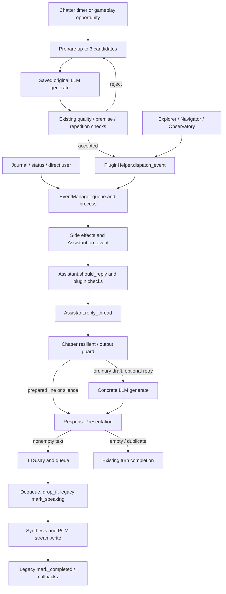

# Speech lifecycle tracing — Phase 2 / PR 1

This change observes the existing speech pipeline. It adds no arbiter, suppression,
requests, cooldown changes or Chatter wrapper refactoring. Enable it before starting
the Python backend with `TARS_SPEECH_TRACE=1`. It is disabled by default.
Records use the existing logger's `speech_trace` JSON field (schema version 1).

## Verified pipeline

`EventManager.process` persists incoming events, updates projections and invokes
side effects. Explorer and Navigator apply their existing freshness, session and
callout gates before dispatch and in registered reply checks. Observatory dispatches
`TARSObservatoryFact` after its existing live/history/cursor filtering. Host tracing
does not reinterpret those payloads or repeat their checks. Galaxy and Expedition
remain integrated through their existing actions/projections. The six-plugin bundle
and its provenance are unchanged by this PR.

`Assistant.should_reply` selects from the entire pending set. An incoming event's
`reply_selection` therefore describes the pending set, while `reply_selected`
identifies the actual selected direct-user/tool/plugin event. `reply_event` links
all unresponded events read back from memory to a fresh reply trace.

`ResponsePresentation.ExplorationCalloutDeduper` removes exact repeated sentences
for exploration context within its existing 12-second window, **after** generation.
Direct questions and tool results retain their existing bypass. Partial deductions
report sentence counts; empty results report `exploration_deduplication`.

## Record semantics and privacy

- `trace_id`: opaque reply ID, propagated into queued lines and playback threads.
- `event_id`: process-salted identity from event type/kind/timestamp/name; survives
  persistence/reload within a process, and is not a content hash. Separately created
  duplicate events remain separate observations. Identical serialized event
  identities cannot be distinguished. IDs are not stable across restarts.
- `line_id`: opaque queued text-line ID, retained across retries of that line.
- `attempt_id`: each concrete model `generate` invocation, including calls through
  Chatter's saved original method. This does not count SDK-internal HTTP retries.
- `path`: fixed `model`, `chatter_candidate` or `chatter_guard`, detected from known
  caller function names only when tracing is enabled. No frame locals are read.
- Known Chatter log prefixes become fixed reason codes via `Logger.log`; original
  log text, rejection details and responses are never copied into trace records.
- No prompts, conversations, plugin payloads, commander/location/body names, file
  paths, credentials or exception messages appear in the new records.

Candidate generation on timer threads precedes the event and often has no reply
context. Those attempts receive separate IDs. They must not be falsely joined to
a later dispatched event or counted as spoken lines. Existing decisions that have
no recognized host/log observation remain unknown; missing traces do not establish
silence. Dynamic assignments of `model.generate` outside the model subclass
boundary can also be invisible. There is no new wrapper around Chatter itself.

Logging failures are swallowed. With tracing disabled, model wrappers immediately
delegate without stack inspection, UUID generation or record creation. Other hooks
return before inspecting event content. No diagnostic state is persisted in events.

## TTS observations and proposed next-phase outcome contract

The current `TTSLine` speaking flag is set **before synthesis or a successful audio
write**. Completion can mean an empty item, `drop_if`, queued cancellation, drained
synthetic audio or an interrupted stream. Synthesis exceptions are swallowed by
the existing `_stream_audio`; playback exceptions requeue the item. The existing
`on_complete` callback can run even when playback is requeued. None establishes
that speech was heard. This PR deliberately preserves all those behaviors.

`playback_started` means a nonempty PCM `stream.write` returned. It does not mean
the output device was audible. `playback_returned` distinguishes cancellation,
no audio and completion of the write loop, and reports written byte counts.
`synthesis_failed` and `playback_failed` remain separate observations. Every
`line_completed` keeps `playback_success: "unknown"`; no `spoken_success` is emitted.
The text speech path has this byte-level instrumentation; audio-file playback
currently has dequeue/failure observations only, not byte-level start evidence.

For the next phase, propose an explicit immutable result per line/attempt:

| Field | Proposed meaning |
|---|---|
| state | queued, synthesizing, writing, draining, terminal |
| outcome | completed, cancelled_before_start, interrupted, dropped, synthesis_failed, output_failed, no_audio |
| written_frames | Frames successfully accepted by the output API, not generated bytes |
| output_drained | Explicit output-device drain acknowledgement; unknown if unsupported |
| started_at / ended_at | Monotonic times, separate from wall-clock diagnostics |
| reason | Fixed code, no exception text or conversation |

Terminal results should be settled once; retries should have separate attempt IDs.
Callbacks and waiters should consume that result instead of equating completion
with speech success. Even a drain acknowledgement cannot prove human audibility.
This contract is a proposal only; this PR does not change the public TTS API.

## Deterministic generation evidence

`test/lib/test_speech_trace.py` uses the real host methods, real bundled Chatter
entrypoint and fake models/audio. Controlled sequences demonstrate:

| Existing path | Concrete model calls | Dispatch / speech queue |
|---|---:|---:|
| Two short Chatter candidates then an accepted candidate | 3 | 1 dispatch |
| Chatter model-selected SKIP | 1 | 0 dispatch |
| Output guard rejects first draft and accepts replacement | 2 | One returned draft |
| Explorer then Observatory with the same generated sentence | 2 | 1 TTS line |
| Normal direct user question | 1 | 1 TTS line |

These demonstrate generation that can be discarded; they are not measurements of
live user traffic or a claim that all retries are avoidable. No path is optimized
or newly suppressed. Tests also cover no audio, swallowed synthesis failure,
output failure/requeue, interrupted playback, queue cancellation, `drop_if`, event
processing/reload identity, opt-out and a failing diagnostic sink.

## Dependencies and validation baseline

Base: TARS PR #14, `audit/tars-safe-persistence-phase1` at
`d3886b4eff27268b7d8fa489ffebb01fa07fb0b3`, which contains PR #13 at
`7a447a4c37d5b91808ad9b4fc5b4147e0336f4c9`. The unmodified bundle pins
TARS-Plugins PR #22 at `8c4223a8764db12f841fe3de3acf6836a63073e2`.
The external plugin checkout was advanced to that revision for compatibility
validation; it was never downgraded to the older five-plugin audit revision.
No commits or branches of PR #13, #14 or #22 were modified or merged.

The legacy `test/tars_baseline` fixture still requires the exact older
`685e16a19d5a5cd83f16297b90ee4c58ba8e11b5` revision. Its nine fixture errors are
reported separately; do not change its pin or downgrade the current plugin
checkout to make them appear green. The current bundle verification and current
plugin tests are the relevant six-plugin checks.

Validation on the implementation:

| Check | Result |
|---|---|
| Full Python suite, tracing disabled | 351 passed; 9 legacy fixture errors |
| Full Python suite, `TARS_SPEECH_TRACE=1` | 351 passed; same 9 legacy fixture errors |
| New deterministic speech tests | 18 passed |
| TARS-Plugins PR #22 tests | 89 passed |
| Electron tests | 16 passed |
| Bundle provenance | 27 files verified at PR #22 revision |
| Production UI build | Passed with repository optimization/budgets unchanged |
| Python dependency consistency | `pip check` passed |

No tests were skipped or disabled to obtain these results. The nine fixture errors
remain visible in the full suite's nonzero exit status; they are not passes.
Optional `sherpa-onnx==1.10.29` installation reached the documented wheel index but
the wheel download was denied by the environment proxy (403), first on
`huggingface.co` and then on its `us.aws.cdn.hf.co` redirect. The required
domains have been added to the saved environment network draft; the final CDN
retry still returned 403.
That model dependency does not block the tested backend development paths.
