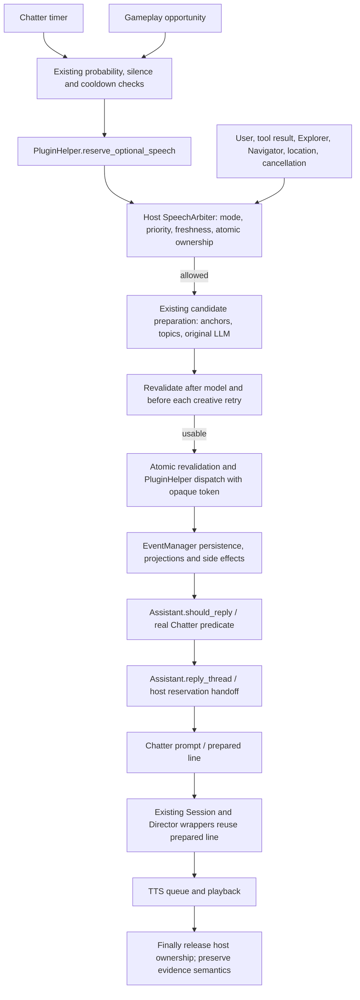

# Speech Director Phase 2 / PR 3: Chatter admission

Base: TARS #16, `feature/speech-admission-gate`,
`d61d903e8f780b36d6be650b72cf37aac60d2bd6` (includes #15/#14/#13).
Companion: https://github.com/rex688-png/TARS-Plugins/pull/23, stacked on #22,
`feature/chatter-host-admission` at `fef38e9f11350555d7b06dbcc88d13d52ddcfa8e`.
The host bundle pins that new immutable commit. All six plugins remain present;
only Chatter's payload and manifest change. Existing PR branches are unchanged.

## Verified pipeline



Preparation ownership is distinct from the host's active reply reservation. An
optional candidate never takes the direct-question execution slot. The helper
also checks incoming events before EventManager has delivered side effects.
User/tool/important-plugin activity invalidates optional preparation; native
reply-eligible events and host reply activity are checked before generation and
dispatch. A location change, TTS abort revision, restart, mode transition involving
`enforce`, or expired opportunity also invalidates it. Freshness uses both a
monotonic deadline and the original opportunity's wall timestamp (60 seconds),
not a newly stamped candidate dispatch time.

States are `preparing -> dispatched -> consumed -> released`. Chatter's context
manager releases failed, silent, SKIP or rejected preparation. A dispatched
`enforce` capability transfers to Assistant and survives plugin context exit;
`finish` releases it after the host turn. Predicate rejection/exception and host
admission rejection discard its token. Plugin stop cancels remaining capabilities.
An unconsumed ticket expires after 60 seconds and is pruned on the next reservation.
Old prepared events cannot populate a higher-priority question's prompt after
invalidation. Persisted events and conversation/memory handling are unchanged.

`off` and default `observe` retain existing behavior and generation counts;
shadow capabilities never suppress those candidates. Only `enforce` suppresses
work. No classifier, new output wrapper, prompt/style replacement, provider/STT/
memory/vision/action changes, or additional OpenAI request is introduced. Older
plugin hosts without the capability keep their previous path. Configuration and
speech preference persistence use the unchanged PR #16 mechanisms.

## Confirmed PR #16 corrections

Before the fixes, two deterministic regressions failed:

1. `assistant_completed` recalculated `reply_pending` from an emptied pending
   list and erased an unsolicited `busy` retry. The ordinary 100 ms Chat poll now
   retains deferred events through completion and retries without new gameplay.
   Explorer and Navigator variants are tested. Deferred events also survive
   dropping outside the 150-event history window. Expired opportunities clear
   pending state instead of polling indefinitely.
2. A competing `reply_thread` could return `busy` and clear `is_replying` while
   its owner was still running. In `enforce`, a nonblocking execution lock leaves
   ownership intact and requests a later poll. Once the store acknowledges the
   first turn, that poll exits without another model request.

Repeated busy polls do not generate. Reservations release in `finally`, including
provider failures; direct questions/tool results still bypass unsolicited admission.
No existing PR was modified to apply these fixes.

## Measured model requests

These are actual calls to the fake underlying `LLMModel.generate` in deterministic
replays, not estimates of OpenAI billing or live-game measurements. Both real
Chatter entrypoints, candidate checks, original wrappers, helper, arbiter and
EventManager processing are exercised. Clocks and scheduling are controlled.

| Controlled scenario | off | observe | enforce |
|---|---:|---:|---:|
| Normal admitted commentary | 1 | 1 | 1 |
| Host reservation busy before preparation | 1 | 1 | 0 |
| Explorer/Navigator event already incoming | 1 | 1 | 0 |
| Two weak drafts, then a usable different subject | 3 | 3 | 3 |
| Model-selected SKIP | 1 | 1 | 1 |
| Generation exception | 1 | 1 | 1 |
| Question arrives during first weak candidate | 3 | 3 | 1 |
| Two simultaneous opportunities | 2 | 2 | 1 |
| Slow candidate finishes after freshness deadline | 1 | 1 | 1 |
| Gameplay opportunity already stale before preparation | 1 | 1 | 0 |
| Existing deliberate-silence choice | 0 | 0 | 0 |

The prepared-event host handoff makes **zero additional underlying model requests**
in all three modes: total normal cost remains one. Quality retries remain useful
when permission is still valid. Once invalid, `enforce` makes no further attempt
and does not dispatch. Slow results cost one already started call and are discarded.
A direct question can generate and queue fake TTS while an optional candidate is
still in flight; finishing that optional call cannot create a competing response.
Timer rejection at dispatch schedules another check after ten seconds.

## Validation and environment

| Check | Result |
|---|---|
| Full Python suite, historical audit dependency isolated, tracing off and on | 488 passed in each run, zero failed/skipped |
| Speech integration/regressions (subset above) | 146 passed, including 81 new cases |
| Canonical TARS-Plugins unittest discovery | 92 passed |
| Electron tests (`node --test test/electron/*.test.js`) | 16 passed |
| Production UI (`npm run build:ui`) | passed; existing CommonJS warnings |
| Six-plugin bundle provenance + exact pinned Git objects | 27 files verified |
| `python -m pip check` | no broken requirements |
| Optional `sherpa-onnx==1.10.29` retry | downloaded, installed, version import verified |

The ordinary full-suite command on the current plugin feature checkout reports
nine pre-existing fixture setup errors: the historical five-plugin audit requires
exactly `685e16a19d5a5cd83f16297b90ee4c58ba8e11b5`. It is incompatible with a
current six-plugin checkout by design. Those are dependency-location errors,
not code/test assertion failures. To validate them, a detached worktree at
`/tmp/tars-pr3-legacy-plugins` supplies only that audit's dependency; its revision
assertion and all test assertions remain intact. The complete historical audit
file passed **13/13**, and the full suite with that isolated fixture passed above.
The main TARS-Plugins checkout stayed on the new feature commit throughout.

Session commands (after `source /workspace/.setup/runtime.sh`):

```bash
python -m pytest -q test/lib/test_chatter_admission.py test/lib/test_speech_arbiter.py test/lib/test_speech_trace.py
python tools/verify_tars_bundle.py --source /workspace/TARS-Plugins
# Run from TARS-Plugins:
python -m unittest discover -s tests -v
```

For the isolated full run, `/workspace/.setup/pr3_legacy_fixture.py` is a temporary
pytest plugin that changes only the loaded audit module's `PLUGINS_ROOT` and
`PLUGIN_DIRECTORY` to the detached worktree. Invocation:

```bash
PYTHONPATH=/workspace/.setup python -m pytest -q -p pr3_legacy_fixture
```

Raw validation logs are in `/workspace/.setup/pr3-*.log`. Neither diagnostics nor
new trace fields contain conversations, candidates, prompts, gameplay identifiers
or exception messages. Tests assert absence of private sentinel data from the
structured trace. `TARS_SPEECH_TRACE=1` remains opt-in; policy mode stays a persisted
configuration field, default `observe`.

## Limits and next step

An in-flight provider request can finish; cancellation stops subsequent retries,
dispatch and prepared-line reuse, rather than adding an HTTP abort mechanism.
Existing output Director regeneration on ordinary host responses is preserved.
The tests demonstrate controlled model costs and priority behavior, not live-game
quality, personality ratings, perceptual frequency, or audible delivery. No speech
model weights or real audio device were required for backend work. Production UI
build succeeded; Windows installer/native packaging was not run on Linux.

Next, give TTS an explicit terminal outcome contract (`played` with output-write
count versus `cancelled`, `failed`, `dropped`, `no_audio`), including cancellation
identity and a guaranteed terminal signal. `TTSLine.completed` still does not
prove audible playback. This PR retains PR #16's evidence semantics and never
persists a successful-spoken acknowledgement from mere line completion.
