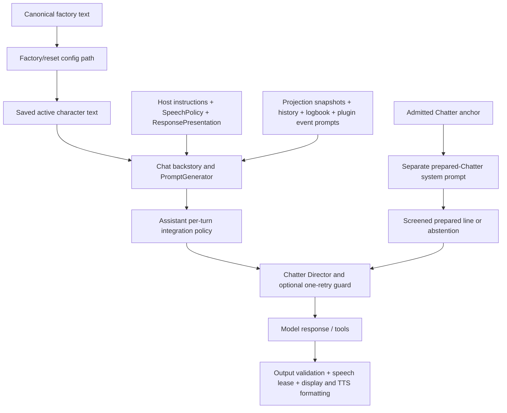

# TARS prompt architecture experiment

**Recommendation: retain the existing factory default.** This candidate has not
been compared using real model outputs. A cleaner instruction layout and a smaller
request are not evidence of better conversation. Nothing here is loaded by normal
startup, saved profiles, reset-to-default, plugin hooks or packaging.

## Verified baseline

On 2026-10-30, GitHub open PRs, remote heads and ancestry were checked before
creating `experiment/prompt-architecture` from host integration-reliability Draft
[#27](https://github.com/rex688-png/TARS/pull/27), head
`98499ec4ab9ad59d42f05c47e586ac0a507bb884`. Its Windows and security workflows have
now completed successfully. That is **base-head evidence**, not this experiment's CI.

Its parents remain unchanged: host corrective #25 `466e2ed3`, Combat #26
`c3cb04b2`; canonical plugin corrective #28 `54c91614` and Combat #29
`83caceaca39712d1c84e4337a09b020b087125ae`, following #27. Earlier host #24 is also
open. The canonical factory and all 32 bundled payload files retain that exact
pin. No plugin PR or provenance change is required for an isolated host-side
experiment. No existing branch was modified, rebased or force-pushed.

The actual factory is **2,693 words / 597 logical lines / 18,280 characters**.
`wc -l` reports 596 newline characters because its final line lacks a newline.
The candidate is **1,971 words / 311 lines / 13,424 characters**. Those are text
measurements, not quality scores, provider tokens or measured inference savings.

## Actual instruction assembly



Concrete paths inspected:

- `src/lib/Config.py`: `_tars_prompt_path`, `getTarsDefaultCharacter`,
  `_apply_tars_factory_defaults`, migrations and reset handling. The canonical file
  seeds factory text; ordinary operation uses the selected saved character.
- `src/Chat.py`: selected character/backstory flows into PromptGenerator. Editing
  a bundled file would not safely constitute an approved migration of user text.
- `src/lib/PromptGenerator.py:3625`: conversation/history/status/logbook assembly.
  At line 3767, the COVAS:NEXT-derived host preamble is concatenated with
  `LIVE_EXPLORATION_SPEECH_POLICY`, `RESPONSE_POLICY`, then formatted personality.
  Plugin handlers contribute separate user-role external-event context.
- `src/lib/ResponsePresentation.py`: freshness/source instructions, exact
  whole-output abstention recognition, unsolicited rejection and display formatting.
  `BodyPresentation.py` / `SpeechText.py` separate some displayed and spoken forms.
- `src/lib/Assistant.py`: event admission/empty-event checks precede generation;
  Combat policy is appended before the main model wrapper. Deterministic alerts,
  authorized fast controls and some prepared paths bypass conversational generation.
- Canonical `TARSChatter.py`: `_install_output_director`, `_inject_director`,
  `_prepare_chatter_line`, `_repetition_reason`, routine/spontaneous quality checks,
  and `_chatter_prompt`. The Director appends continuity/style rules to recognized
  normal prompts; one rejected draft may be regenerated, but intentional abstention
  precedes quality rejection. Optional line preparation has its **own** system
  prompt and up to three topic attempts; explicit SKIP ends the search.
- Explorer/Navigator/Observatory prompt callbacks, Expedition/Galaxy action
  descriptions and returned `assistant_instruction` fields provide narrower
  scientific, routing, finance and source-limit contracts.
- `SpeechArbiter`, `ExplorationSpeech`, host scheduling and plugin opportunity
  checks determine whether work can speak. Personality text cannot replace their
  freshness, deduplication, priority, replay or delivery-evidence contracts.

## Findings: verified text/call paths versus unmeasured effects

| Finding | Evidence and classification | Consequence / treatment |
| --- | --- | --- |
| Repeated source ownership | Factory SOURCE PRIORITY, domain sections, PLUGIN BOUNDARIES and RESPONSE PRIORITIES restate owners; tool descriptions and result instructions repeat routing. **Confirmed duplication.** | Candidate states the general owner rule once, retaining exact detailed domain contracts. Tool definitions remain authoritative and unchanged. |
| Numeric source ranking versus domain ownership | Factory explicitly says ownership outranks its numbered list. **An explicit exception, not a proved logical contradiction.** | Candidate uses owner-first prose. Current-state freshness and native-data preference remain. |
| Detailed answers versus global brevity | Host allows natural significance-based length; factory allows detail; Director globally says “One concise sentence is preferred.” **Confirmed scope tension, not a measured failure rate.** | Candidate makes requested depth explicit. Director is unchanged in the A/B, so this competing preference remains visible. |
| Speech versus display | Factory says “A one”; ResponsePresentation requests compact visible labels and numeric quantities. BodyPresentation has separate spoken output; full procedural names/moon suffixes are left to the model. **Confirmed split responsibility/text tension.** | Pronunciation contract retained verbatim. Do not move all pronunciation to runtime until full identifiers have equivalent coverage. |
| Number formatting | Host preamble says no commas in numbers; final display formatting can insert thousands separators. **Confirmed differing stage conventions.** | No formatting rewrite. Evaluate both visible reply and final spoken output before consolidating wording. |
| IMPORTANT versus admitted plugin opportunities | Legacy preamble says react only to IMPORTANT events; newer host wording permits enabled prioritized opportunities; PluginHelper formats external prompts without an IMPORTANT requirement. **Confirmed instruction-scope mismatch; no incident attribution.** | Leave production behavior unchanged. Any future wording correction belongs in the host, with real plugin-handler regressions. |
| “Humor: 75%” | Factory gives an unexplained scalar, while Director explicitly says intensity, not frequency. **Confirmed ambiguity already qualified by another layer.** | Candidate explains it locally and permits straight, positive, warm answers. No joke quota. |
| Stock-phrase prohibitions | Factory Explorer/Chatter lists overlap Director/preparer/topic guards, including cosmic personification and bureaucracy. **Confirmed repetition; effect on originality remains a hypothesis.** | Candidate replaces general style lists with fresh-premise/context guidance. Hard event-specific and quality guards stay unchanged. |
| Prepared Chatter is a separate prompt | `_prepare_chatter_line` generates with its own system/user text, not factory text; screened delivery can return it verbatim. **Confirmed call-path boundary.** | Factory-only refinement cannot be credited with improving that generation. Exported paired requests for this path are identical. |
| Requested conversation and spontaneous restrictions | Many Chatter restrictions are correctly conditional on spontaneous/routine turns. Global repetition and brevity rules can still affect direct answers. **Confirmed mixed scope; blandness is unmeasured.** | Test invited philosophy, technical depth, teasing and multi-turn exchange separately. Do not label all scoped restrictions as defects. |
| Apparent prompt responsibility for delivery | Prompt repeats silence/dedup/source instructions already supported by host admission. **Confirmed layering, not proof the text is redundant.** | Keep semantic grounding instructions: runtime cannot verify arbitrary natural-language claims. Do not replace model accuracy rules with a delivery lock. |

The audit has not established that the long prompt caused any particular bad line,
that removing a phrase blacklist improves originality, or that fewer tokens makes
TARS more enjoyable. No qualitative scores or invented “before/after” quotations
are presented as model evidence.

## Candidate and protected contracts

Read [candidate.txt](candidate.txt). Its first part describes identity, requested
conversation, selective initiative and reliable work positively. It permits
interesting invited discussion, useful detail, friendly teasing, occasional warmth
and plain factual answers. It asks for a new idea rather than a new wording of the
same joke; silence remains valid for unsolicited work.

The following factory sections are retained **verbatim**, with a baseline SHA-256
and executable check in [retained-contracts.json](retained-contracts.json): SPEECH,
COVAS NATIVE DATA, TARS EXPLORER, TARS NAVIGATOR, TARS EXPEDITION, TARS GALAXY,
ENGINEERING MATERIALS, VISUALS, ACCURACY. This deliberately retains technical
negative rules where a broad stylistic substitute would be unsafe.

Retained protections include exact internal IDs/pronunciation, FSS identification
versus per-body DSS mapping, biological signal/sample distinctions, composition,
real NavRoute versus straight-line distance, arrival versus docking, owner-only
expedition routing/history/rebuild, recorded sales and payout splits, external
proxy/source failures, live versus historical facts, honest missing data, fresh
visuals and no invented observations/memories. Runtime permissions, replay safety,
speech admission, delivered-fact deduplication and abstention handling are unchanged.

No technical rule has been relocated into production. The appendix is part of
this **one experimental prompt**, not a new runtime policy engine.

## Relocation recommendations and evidence needed

| Responsibility | Existing execution path | Recommendation |
| --- | --- | --- |
| Event eligibility, stale output, duplicate delivery, direct priority, replay | Assistant + SpeechArbiter + plugin freshness guards | Already runtime-owned. Preserve it; do not substitute model discretion. Existing integration regressions remain required. |
| Domain routing and result meaning | Current tool descriptions / domain result instructions | Good eventual home for domain detail, but many generation turns have no tools and unsolicited turns receive event callbacks instead. Retain factory contracts until all relevant paths demonstrate equivalent protection. |
| FSS/DSS/exobiology | Explorer callback/result instructions + SpeechPolicy + factory | Retain semantic constraints. State machines can identify events but cannot guarantee the final model calls identification “identified” rather than “mapped.” |
| Requested answer length | Host preamble + Director | Consider scoping Director brevity to unsolicited/routine turns in a **separate** measured change. Do not bundle it into this factory-only comparison. |
| Novelty/style | Personality + recent-line Director + conditional quality guards | Evaluate each scope separately; lexical guard deletion requires failing/passing examples and regression coverage. |
| Pronunciation and visible numbers | BodyPresentation + SpeechText + model text | Only partly deterministic. Preserve exact pronunciation requirements now; add full-name equivalence tests before further relocation. |
| Action success and permissions | ActionManager/approvals + result semantics + ResponsePresentation | Runtime permissions remain mandatory. Tool availability and model prose are not authorization. No change. |

If later approved, the production factory change should be made in TARS-Plugins
first and coordinated with a new exact host pin/provenance check. Existing custom
prompts must remain untouched. This experiment provides no automatic migration or
activation mechanism.

## Controlled comparison: executed infrastructure, unexecuted model quality

[scenarios.json](scenarios.json) contains 21 scenarios. Preparation exports **36
requests**: 17 paired main-generation cases plus one paired prepared-Chatter case.
Three runtime-only cases export no model request: routine scanning, overlapping
facts and historical replay. Those are checked by the existing runtime regression
suite; a prompt-only counterfactual must not bypass admission to manufacture speech.

The main arms use the same real PromptGenerator, current plugin callbacks, source
snapshots, unchanged integrated Combat append, real Director, tool descriptions,
conversation/memory fixtures and model settings. Only the factory text differs.
Prepared-Chatter inputs use the actual preparer with one controlled synthetic
anchor/topic; capture returns an internal test sentinel without contacting a model.
Domain tool schemas come from current literal plugin registrations and actual
Pydantic models; the complete native actuator catalogue is intentionally not
started or exported. No action is dispatched. These are generation snapshots,
not a claim of a full live application/model replay.

| Representative scenario | Baseline versus candidate comparison performed | Behavioral result |
| --- | --- | --- |
| Fuel / stale logbook | Identical current 24.7-tonne snapshot and historical conflicting memory | Model accuracy untested |
| Detailed FSS/DSS/exobiology | Same question and runtime policies; technical appendix retained | Requested depth / brevity tension untested |
| ELW discovery / ordinary completed system | Real Explorer prompt callback in both arms | Naturalness, factual restraint and voluntary silence untested |
| Navigator final jump / missing route | Same route evidence or explicit absence | Correct milestone wording and tool routing untested |
| Expedition full report / previous trip / payouts / failed rebuild | Same current schemas and synthetic recorded results | Routing, arithmetic and failure wording untested |
| Friendly parking tease / extended naming discussion | Same confirmed conversation history; factory-only style difference | Humor, originality and continuity untested |
| Direct question about silence | Same explicit request | Correct answer delivery covered by existing host tests; candidate model output untested |
| Prepared spontaneous Chatter | Identical model-input hashes | Factory-only change has no effect on this path's input |
| Repeated events / historical replay / routine scan | No extra model requests created; reuse sanitized journey fixture hashes and selected record counts | Existing runtime integration regressions, not qualitative model scores |

Measured instruction sizes for the frozen snapshots (characters, not tokens):

| Input | Baseline | Candidate |
| --- | ---: | ---: |
| Factory text | 18,280 | 13,424 |
| Main system message, ordinary question | 25,731 | 20,875 |
| Main system message, extended conversation | 25,904 | 21,048 |
| Separate prepared-Chatter system message | 2,198 | 2,198 |

The checked-in [comparison.json](comparison.json) records per-scenario hashes,
character counts, runtime source hashes and null quality results. It is an offline
artifact. `model_calls` is zero. No OpenAI credential is configured in the managed
environment, so **no real model outputs were collected**. Optional fixed-encoding
tokenization was attempted, but the vocabulary download received HTTP 403 from the
network proxy. Token fields remain null; do not infer token counts from word counts.
No output-token, billed-usage, latency or cost savings have been measured.

## Reproduce and collect evidence

Use existing host development dependencies. No runtime dependency is added.

```sh
PYTHONPATH=src python experiments/prompt-architecture/evaluate.py prepare --output-dir /tmp/tars-prompt-ab
PYTHONPATH=src python -m pytest -q test/lib/test_prompt_experiment.py
```

Preparation uses an in-memory database, frozen synthetic clock, no plugin startup
hooks, no profiles, no microphone, no provider API and no input actuation. It writes
only to the explicitly selected output directory. `--encoding o200k_base` is
optional if `tiktoken` and its vocabulary are already available; its serialized
JSON counts are a fixed-encoding proxy, **not provider/billed token usage**.

For an authorized real-model run, submit exported `messages`, allowed `tools` and
`tool_choice` using the chosen provider adapter with identical model settings for
both arms. Do not send experiment metadata as API parameters. If the provider
changes a setting, regenerate both arms' manifests; do not silently compare
different settings. Alternate/randomize call order, retain provider model snapshot
IDs, repeat the full pair set across multiple runs, and record actual API usage,
errors and latency. Observe tool selection without executing gameplay actions.
One-step tool-routing cases and supplied result cases are separate scenarios;
this harness does not autonomously execute a multi-step agent loop or the Director's
regeneration. Existing host tests cover that guard with deterministic outputs.

Import a complete response list with this shape (example schema, **not evidence**):

```json
[
  {"request_sha256":"HASH_FROM_REQUEST", "settings":{"model":"gpt-6-luna","temperature":0.3,"reasoning_effort":"none"},
   "status":"completed", "text":"ACTUAL_MODEL_OUTPUT", "tool_calls":[],
   "usage":{"input_tokens":0,"output_tokens":0}}
]
```

Replace placeholders and zero usage with actual provider data; omit `usage` when
unavailable. Use `status: "error"` for a failed request. Empty/missing/error results
must never be counted as intentional abstention.

```sh
PYTHONPATH=src python experiments/prompt-architecture/evaluate.py review \
  --manifest /tmp/tars-prompt-ab/comparison.json \
  --requests /tmp/tars-prompt-ab/requests.json \
  --responses /tmp/actual-responses.json --output-dir /tmp/tars-prompt-review
```

The importer rejects missing/duplicate/unknown hashes and mismatched settings.
It does not authenticate an external output's origin; preserve raw provider
records privately for audit. `blind-review.md` hides arm labels; `review-key.json`
is separate. It records output length, actual supplied usage and narrow abstention,
leaving all qualitative scores null. Test-only synthetic answers are not committed
as model comparison evidence.

Review blind pairs for factual accuracy, tool routing, source/time compliance,
correctness constraints, naturalness, distinctiveness, originality, premise reuse,
verbosity appropriate to the request, silence appropriateness and voice rendering.
Record pass/fail/uncertain for factual contracts, a reasoned preference with output
quotes for style, and actual usage separately. Review successive remarks as a
sequence as well as individually. Never infer originality from word-count reduction.

Promotion requires no meaningful correctness/safety regressions and consistent,
explainable conversational benefit in repeated blind review, followed by physical
TTS/microphone and live gameplay acceptance for timing, pronunciation and restraint.
Without that evidence, retain the default. Changing the default or saved prompts
requires separate explicit approval; this Draft does not authorize either.

## Automated results and limits

Local validation: **901 host tests passed**, including **10 new experiment tests**; **142 canonical plugin tests**, **34 frontend tests** and **16 Electron tests** passed. Six existing dependency/fixture serialization warnings remain. Exact 32-file bundle verification, dependency consistency, strict docs and diff checks passed. Two independent preparations produced byte-identical request bundles and comparison manifests. Final CI links are in the Draft PR description. New tests verify
verbatim contract retention, factory-only paired inputs, identical prepared-Chatter
inputs, no model requests for runtime-only cases, real current tool schemas,
unsolicited tool exclusion, provenance-checked review, and error/action-versus-
abstention handling. The complete existing host and canonical suites are also run.

Automated input equivalence and unchanged production code do **not** prove a model
will obey the candidate. No physical Windows, real microphone, TTS listening,
installed Observatory or Elite gameplay test was conducted for this experiment.
No merge, rebase of existing PRs, force-push, tag, release or visibility change.
